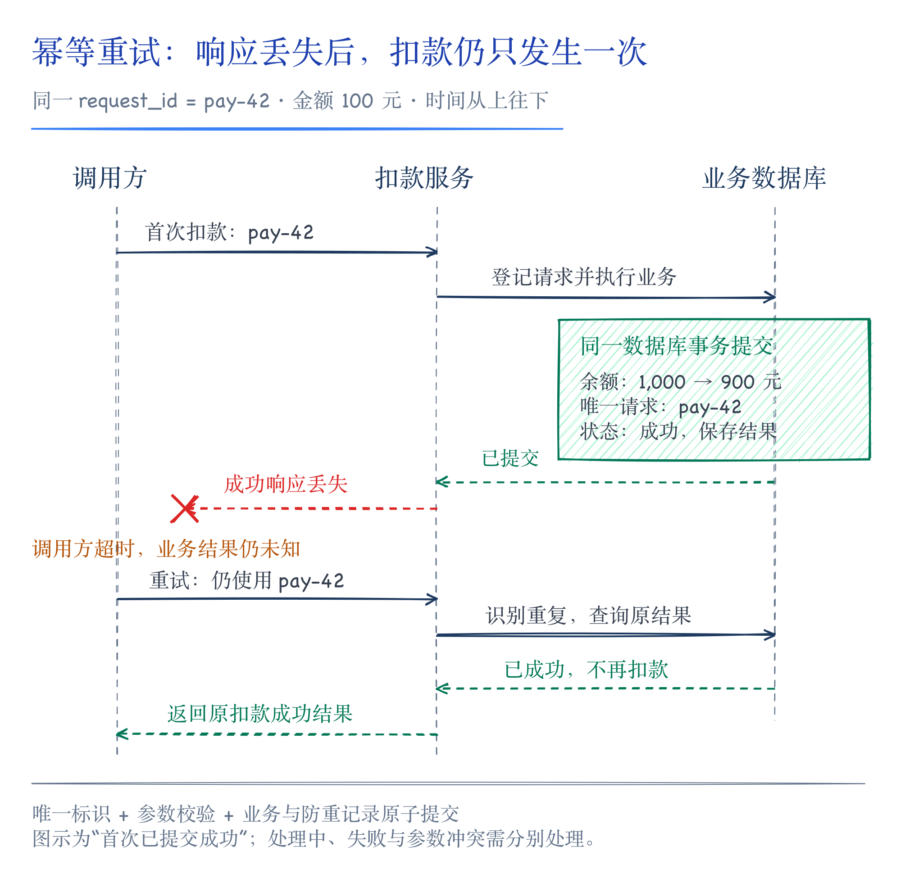
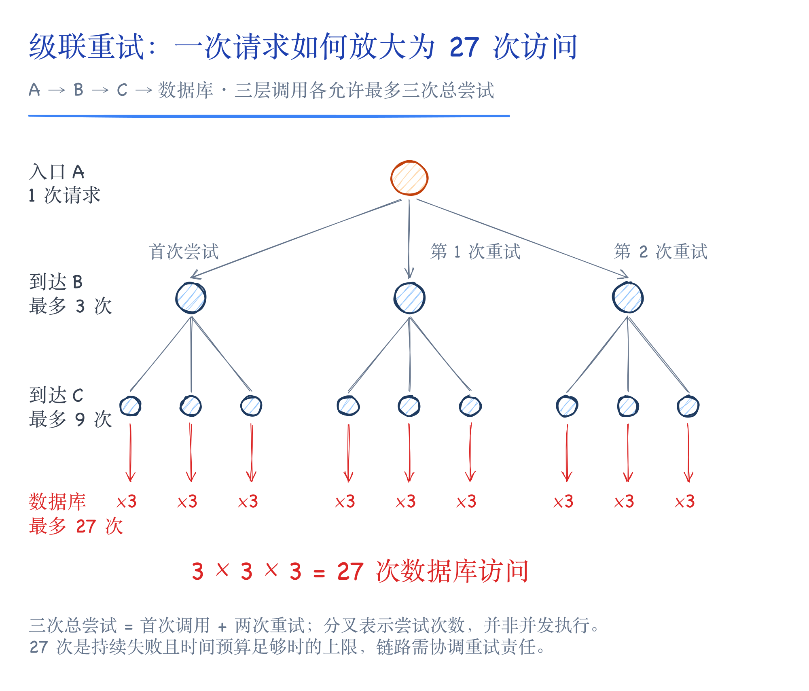
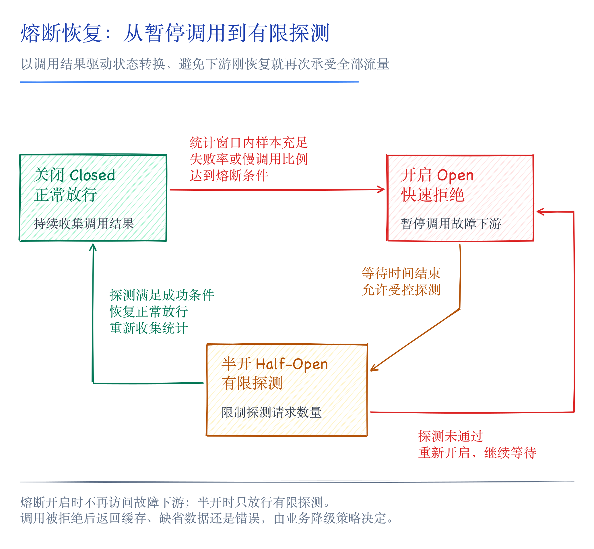
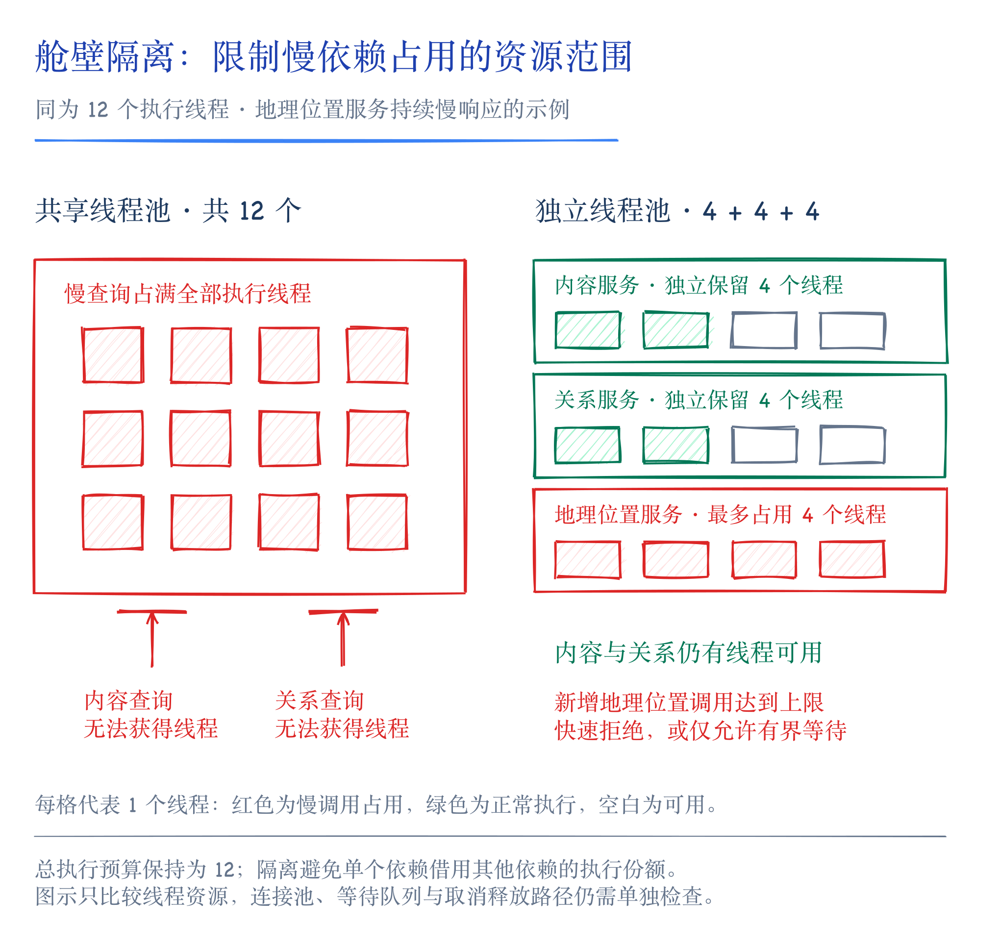
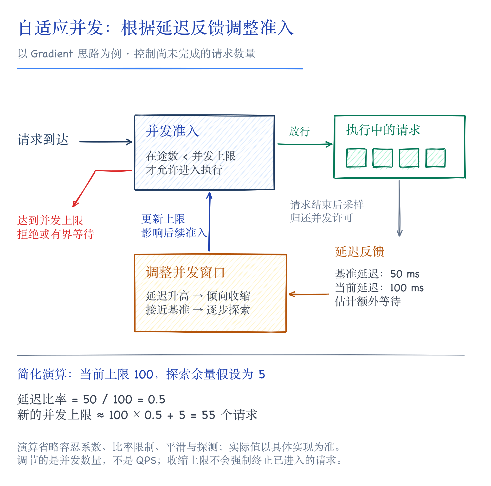

# 服务可用性治理：重试、故障隔离与过载保护

一个用户主页可能同时依赖用户信息、内容列表、关注关系和地理位置等服务。页面请求量没有明显增长，某个下游接口却突然变慢，等待它返回的请求开始积压。如果这些调用共用线程池或连接池，其他原本正常的功能也会受到影响。此时继续增加重试，可能使故障进一步扩大。

《亿级流量系统架构设计与实战》第二章讨论如何提高读写请求的处理能力，第三章则转向服务运行过程中的可用性治理。重试、熔断、隔离、限流和降级分别作用于不同环节：处理短暂失败、暂停异常调用、约束资源占用、控制准入规模，以及在资源不足时保留核心功能。理解这些机制，需要先分析请求在调用链中如何消耗资源。

## 1. 调用链中的故障传播

服务 A 调用服务 B 时，A 是调用方，也是 B 的上游；B 是被调用方，也是 A 的下游。对 A 来说，上游决定有多少请求到达，下游则影响每个请求需要等待多久。两者共同决定了 A 的资源压力。

假设个人页服务需要等待内容列表服务返回，内容列表服务又需要查询计数服务。计数服务变慢后，内容列表请求的占用时间延长，个人页请求也随之积压。即使服务进程始终存活，用户仍可能因长时间等待而无法正常使用页面。

这种影响会沿两条路径传播。一条是依赖链：下游失败使上游无法完成业务；另一条是共享资源：某类请求长时间占用线程、连接或内存，使其他接口也无法获得资源。服务雪崩通常与这两类影响叠加有关，不能只通过检查实例是否在线来判断。

远程调用需要设置超时，整个业务请求也需要有明确的截止时间。假设页面总预算为 800 毫秒，某次下游调用已经消耗 600 毫秒，后续重试就只能使用剩余预算，不能再次获得完整的 800 毫秒。超时后还应停止无意义的等待、释放本地资源；调用方停止等待，并不代表下游已经停止执行。[2]

## 2. 重试与幂等性设计

超时意味着调用方没有按时得到结果，无法单凭这个现象判断业务是否执行。请求可能尚未到达下游，也可能正在处理，还可能已经执行成功，只是响应丢失。重试必须能够处理最后一种情况，否则一次网络异常就可能引发重复扣款或重复创建订单。[2]

幂等性约束的是同一业务操作重复执行后的效果。没有副作用的读取通常可以重试，但两次读取之间数据可能变化，因此返回内容不必完全相同。写操作则需要识别重复请求，并使重复执行不再产生额外的业务变更。[3]

原书介绍了唯一约束、版本校验、Redis 防重标记和 token 等思路。其中，唯一业务标识是贯穿这些方案的基础。订单扣款的重试应沿用同一个订单标识或请求标识；如果每次尝试都重新生成标识，下游就会把它们当作不同交易。相同标识携带不同金额时，也应报出参数冲突。[3]

版本校验适合约束带有预期状态的更新。写入时检查旧版本，并在修改业务字段的同时递增版本号；重试继续携带原来的预期版本，就不会重复执行同一次更新。但影响行数为零，也可能是其他请求已经修改了数据，仍需查询原操作的记录，才能判断本次业务是否成功。[1][3]

以数据库防重表为例，交易记录可以对业务请求标识建立唯一约束，并与余额变更放在同一个本地事务中提交。重复请求到达后，接口查询已保存的处理状态和结果。正在执行、已经成功和处理失败需要分别表达，不能仅凭“这个标识出现过”就返回成功。[3]



*图 1：超时后业务可能已经完成。同一请求标识使重试能够找到原操作的状态与结果。*

Redis 的 `SET NX` 或一次性 token 可以限制重复请求进入，但其原子性只覆盖 Redis 内部的操作。假设服务先写入防重标记，随后在扣款前崩溃，重试会发现标记已经存在，而实际扣款并未完成；如果先扣款再写标记，又会留下重复扣款的窗口。跨存储的业务需要额外维护处理状态、查询结果或补偿流程，单个防重标记无法替代这些步骤。[3]

防重记录的保留时间同样属于接口约定。标记过期后，迟到的重复请求可能再次被接受；保留窗口应覆盖业务允许的重试与补偿周期。幂等设计最终需要同时明确请求身份、并发处理、业务提交和结果返回，而不只是选择一种存储命令。[3]

## 3. 重试预算与退避策略

重试是否有效，取决于失败原因。参数错误、余额不足等业务拒绝，在输入和业务状态不变时不会因重试而成功；短暂连接异常可能通过重试恢复；下游已经限流或熔断时，立即重复调用则会继续增加压力。网络超时也可能由过载引起，不能一律当作可以立即重试的偶发抖动。[2]

一次重试至少要满足三个条件：操作可安全重复，错误属于允许重试的类型，并且剩余时间与重试配额都足够。退避用于拉开连续尝试的间隔，随机抖动则避免大量调用方在同一时刻重新发起请求。指数退避还应设置等待上限，避免退避时间超过业务截止时间。[2]

只限制单个请求的重试次数，还不足以控制调用链上的流量放大。假设 A 调用 B、B 调用 C、C 访问数据库，每一层都允许最多三次尝试，包括首次调用和两次重试。在失败持续存在、时间预算允许的情况下，一次入口请求最多可能触发 27 次数据库访问：



*图 2：各层独立重试会累乘放大下游请求量。三次总尝试包含首次调用，27 次是给定条件下的上限。*

因此，重试责任需要在链路上协调。可以由明确的一层负责主要重试，也可以传递尝试次数和剩余预算，防止各层独立叠加。原书提出识别上游重试请求、抑制下游继续重试的做法，其目的也是限制级联放大。[1][2]

服务整体还需要重试预算。例如，以滑动窗口统计首次请求数和额外重试数，将额外重试目标控制在首次请求的 10% 以内。这个比例只是一个策略示例，实际值应结合容量确定；实现时，配额检查与占用需要并发安全。分实例统计和滑动窗口的边界，也意味着这一目标不能直接当作任意时刻都成立的全局硬上限。[1]

## 4. 熔断检测与恢复探测

重试适合争取短暂故障后的成功机会。下游持续异常时，则需要暂停调用，让上游及时释放资源，也给下游留下恢复空间。熔断器根据一段时间内的调用表现决定是否继续放行，并通过有限的探测请求判断何时恢复。[1]

熔断器通常包含关闭、开启和半开三种状态。关闭状态允许正常调用并收集结果；失败率或慢调用比例达到条件后进入开启状态，后续请求被快速拒绝；等待一段时间后进入半开状态，只允许有限的探测请求执行。探测满足恢复条件后关闭熔断，否则重新开启。[1]

统计窗口与最小样本量需要配合。低流量接口只出现一两次失败时，失败率可能已经很高，但样本不足以反映长期状态。另一方面，下游即使最终都返回成功，也可能因响应过慢而持续占用调用方资源。原书以 Hystrix 介绍失败率判断，再以 Resilience4j 和 Sentinel 说明慢调用比例、错误数量等检测方式；这些信号分别反映调用质量的不同方面。[1]

半开状态的作用是受控地恢复流量。休眠时间结束后直接放开全部请求，可能让刚恢复的下游再次过载。探测数量、成功条件和恢复速度，应当结合下游承载能力设置。熔断返回后采用缓存、替代数据还是明确报错，则由业务降级策略决定。[1]



*图 3：恢复流量需要经过有限探测。等待时间结束只意味着可以试探下游是否恢复。*

## 5. 舱壁隔离与并发上限

熔断依赖故障统计，从异常出现到触发熔断之间仍有时间差。资源隔离可以在这段时间内限制单个依赖的占用范围。个人页服务调用内容、关系和地理位置服务时，如果共用一个线程池，地理位置查询变慢就可能挤占内容查询所需的线程。[1]

线程池隔离为不同依赖分配独立的执行资源，某个依赖耗尽自己的线程后，不再继续占用其他依赖的份额。代价是线程、内存和调度开销增加，空闲资源也未必能被其他调用直接使用。因此，隔离粒度通常需要结合依赖的重要性和调用成本确定。[1]



*图 4：总线程预算相同时，独立份额可以限制慢依赖的影响范围。线程隔离之外仍需检查共享连接池和等待队列。*

信号量隔离则限制某类调用的同时执行数量，无须为每个依赖创建独立线程池。调用前申请许可，执行结束后归还；没有可用许可时，应快速拒绝或只允许有界等待。若等待队列可以无限增长，虽然执行中的调用数受控，等待者仍可能耗尽资源。[1]

隔离还应关注连接池和队列。线程份额已经分开，却仍争用同一个被占满的连接池，其他接口仍会受影响。设计隔离时需要明确保护的资源范围，并确认成功、异常、取消和超时路径都会释放相应资源。

## 6. 固定阈值限流与流量整形

限流控制请求是否进入系统，首先要明确控制的对象。按用户限制发布频率属于业务频控；限制单个实例每秒接受的请求数用于保护本机；限制整个集群对共享资源的访问，则涉及全局配额。这几类需求可以采用相似的计数机制，但统计键、作用范围和失败策略并不相同。[1]

频控可以通过带过期时间的计数实现。计数首次创建时，同时设置有效期，避免更新计数成功、设置过期时间失败后留下永久有效的记录。还需要定义计数代表请求尝试还是业务成功：请求通过频控后若执行失败，已经占用的次数是否归还，会直接影响用户体验。[1]

固定阈值下，几种常见算法的区别主要在于统计方式与突发流量处理：

| 算法 | 控制方式 | 需要关注的问题 |
| --- | --- | --- |
| 固定窗口 | 每个固定时间段独立计数 | 相邻窗口边界可能集中放行接近两倍额度 |
| 滑动窗口 | 统计最近一段时间的请求量 | 分桶粒度影响近似误差与维护开销 |
| 漏桶 | 以受控速率放行排队请求 | 平滑流量的同时增加等待，需要限制队列长度 |
| 令牌桶 | 按速率补充令牌，请求消耗令牌后通过 | 允许一定突发，桶容量需与下游承载能力匹配 |

固定窗口的边界问题可以用一个例子说明：每秒限额 100 次，前一秒末尾通过 100 次，后一秒开头又通过 100 次。两个固定窗口各自符合规则，但很短时间内仍可能有 200 次请求到达下游。滑动窗口通过统计最近一段时间缓解这种边界效应。[1]

漏桶适合控制输出节奏，令牌桶则允许空闲期间积累一定额度。令牌补充速率决定长期放行速率，桶容量决定可积累的突发额度。令牌充足时，请求可以集中通过，因此令牌桶并不保证任意一个短时间段内的流量都均匀。[1]

请求速率与执行并发数也需要分别控制。相同的每秒请求量，在处理时间从 20 毫秒增加到 500 毫秒后，会占用更多并发资源。令牌桶可以限制进入速度，但不能单独限制尚未完成的请求数量；服务通常还需要并发上限和有界队列配合。[1]

## 7. 全局限流与配额分配

单机限流保护的是某个实例。若每个实例都允许每秒 1,000 次请求，实例数量从 5 个增加到 10 个后，集群总放行能力也会变化。对于外部接口调用配额、租户总额度或共享存储保护，业务可能需要独立于实例数量的全局限制。[1]

直接的方案是由所有实例访问统一的配额服务。配额检查和扣减集中进行，较容易维持一致的计数口径，但每次业务调用都会增加一次网络访问，配额服务也会成为新的依赖。它自身的容量、热点键和故障处理，都需要纳入设计。[1]

另一类方案将决策留在本地。实例周期性上报流量，控制端根据汇总结果下发配额或丢弃比例，实例据此放行请求。这降低了逐请求协调的成本，但反馈存在延迟，概率丢弃也只能在统计意义上逼近目标。流量骤增、实例扩缩容或配额闲置时，控制结果可能偏离预期。[1]

选择方案时，应区分保护性限流与业务正确性约束。允许短时超出目标的流量整形，可以采用近似统计；订单不能超卖，则仍需由库存扣减的原子条件保证。入口限流能够减轻库存服务压力，但请求通过限流并不等于已经获得库存。[1]

## 8. 自适应限流与容量估计

固定阈值依赖对服务容量的估计，而容量会随代码、请求类型、机器资源和下游延迟变化。相同的 QPS，有时大部分请求命中缓存，有时需要执行复杂查询，资源消耗可能相差很大。自适应限流通过运行时信号调整准入规模，减少对固定容量假设的依赖。[1]

原书介绍的 Dagor 方案使用请求开始处理前的平均排队时间判断过载。排队时间持续增加，说明请求进入系统的速度已经超过当前处理节奏。相比单看 CPU 利用率，这种信号更直接反映请求是否在等待；CPU 不高时，服务仍可能受连接池或 I/O 等待限制。排队时间阈值需要结合具体服务目标设置。[1]

Netflix 的 Gradient 思路通过比较低负载基准延迟与当前采样延迟，估计额外等待的程度。其核心关系可以简化为：

```text
延迟比率 = 基准延迟 / 当前延迟
新的并发上限 ≈ 当前并发上限 × 延迟比率 + 探索余量
```

当前延迟接近基准时，算法保留逐步扩大并发的空间；延迟明显升高时，则倾向于收缩。实际实现还包含比率限制、平滑、上下界以及基准延迟探测等处理，避免单次异常采样引起剧烈变化。它调节的是并发窗口，不能简单理解为自动计算一个固定 QPS。[4]



*图 5：延迟反馈用于调整后续请求的准入窗口。图中数字为简化示例，未包含具体实现的全部修正项。*

BBR limiter 则结合 CPU 负载、完成请求的速率和响应时间估计可接受的在途请求数量。其容量估计可以结合利特尔法则理解：

```text
平均在途请求数 = 平均完成速率 × 平均停留时间
```

在稳定状态下，若系统平均每秒完成 1,000 个请求，每个请求平均停留 0.05 秒，则平均在途请求数约为 50。这里得到的是请求数量，单位不是“请求/秒”。BBR limiter 使用采样得到的最大完成速率和最小响应时间估计并发容量，再与当前在途请求数比较；这是一种控制启发式，不等同于直接测得系统的绝对容量。[1][5]

自适应算法仍需配置和验证。采样窗口、初始并发、上下界以及恢复速度都会影响效果。不同请求类型混在同一个窗口中，也可能使延迟变化难以解释。它可以动态调整保护力度，但不能替代容量测试、故障演练和对实际业务延迟的观察。[4][5]

## 9. 依赖分级与读写降级

限流与熔断决定哪些调用暂时不执行，降级则定义这些调用缺失后，业务还可以提供什么结果。个人页展示中，用户身份和主要内容可能属于强依赖，地理位置或部分统计信息可以暂时缺省。依赖的重要程度应由具体场景确定，同一个服务在不同链路上的优先级未必相同。[1]

活动保障期间，可以预先划分依赖等级，通过配置逐步停止非核心调用。配置项应清楚表达“启用该功能”还是“启用降级”，并在上线前验证实际行为。降级后如果仍在后台执行原有高成本调用，页面虽然变简单，资源压力却不会相应下降。[1]

读请求可以使用已有缓存、静态数据或替代数据源。推荐服务不可用时返回离线计算的热门内容，能够保留浏览能力，但会暂时降低个性化程度。旧数据可使用多久、哪些字段可以缺省，都需要业务确认。展示缓存也不能替代交易时的价格、权限或库存校验。[1]

兜底链路本身需要有容量准备。正常状态下几乎没有流量的备用服务，在主链路故障后可能突然接收大量请求。兜底如果继续依赖同一个故障数据库，也未必能够降低失败率。降级设计应检查替代路径实际减少了哪些依赖和计算。[1]

写请求可以通过异步处理、批量聚合或缩小传播范围降低即时成本。异步受理后，应区分“已接收”和“已完成”，并处理任务积压、重复消费和失败恢复。原书的直播弹幕案例通过减少广播范围缓解扇出压力，但这种取舍依赖业务允许部分消息不传播的前提，不能照搬到订单或扣款等必须可靠记录的操作上。[1]

## 10. 治理策略的协同与验证

这些机制需要共同服务于一条业务链路。入口根据配额、优先级和当前负载决定是否接收请求；调用下游前检查熔断状态并申请并发资源；失败后结合幂等性、错误类型、剩余时间和重试预算决定是否再次尝试；无法完成调用时，按照预先约定返回降级结果或明确错误。[1][2]

策略之间也可能相互抵消。例如，下游主动限流，上游却立即重试，会增加无效流量；熔断器暂停调用后，降级逻辑仍访问相同的故障依赖，便无法隔离影响；每个线程池都设置独立额度，但总额度超过机器容量，也仍然可能过载。组件配置需要放回完整链路中验证。[1][2]

验证应覆盖具体故障过程。注入下游慢响应后，观察其他接口是否受到资源挤占；模拟业务执行成功但响应丢失，检查重试是否产生重复写入；持续增加流量，观察拒绝率、排队时间和成功请求延迟；恢复下游后，再检查探测与流量恢复是否平稳。这些过程能够暴露仅靠正常路径测试难以发现的问题。

监控也应区分首次请求与重试请求、主动拒绝与执行失败、正常响应与降级响应。错误率下降可能来自更早地拒绝请求，平均延迟改善也可能来自大量返回兜底数据。只有把成功完成的核心业务量、尾部延迟和降级比例放在一起观察，才能判断治理措施是否达到了预期。[1][2]

## 参考资料

[1] 李琛轩：《亿级流量系统架构设计与实战》，第三章“通用的服务可用性治理手段”，电子工业出版社，2024。

[2] Marc Brooker：[Timeouts, retries, and backoff with jitter](https://aws.amazon.com/builders-library/timeouts-retries-and-backoff-with-jitter/)，Amazon Builders’ Library。超时、级联重试、重试预算与随机退避。

[3] Malcolm Featonby：[Making retries safe with idempotent APIs](https://aws.amazon.com/builders-library/making-retries-safe-with-idempotent-APIs/)，Amazon Builders’ Library。请求标识、业务提交原子性、重复请求响应与参数冲突。

[4] Netflix：[concurrency-limits · GradientLimit](https://github.com/Netflix/concurrency-limits/blob/main/concurrency-limits-core/src/main/java/com/netflix/concurrency/limits/limit/GradientLimit.java)。延迟梯度、并发窗口与探测逻辑。

[5] go-kratos：[aegis · BBR limiter](https://github.com/go-kratos/aegis/blob/main/ratelimit/bbr/bbr.go)。在途请求容量估计与过载判定。
